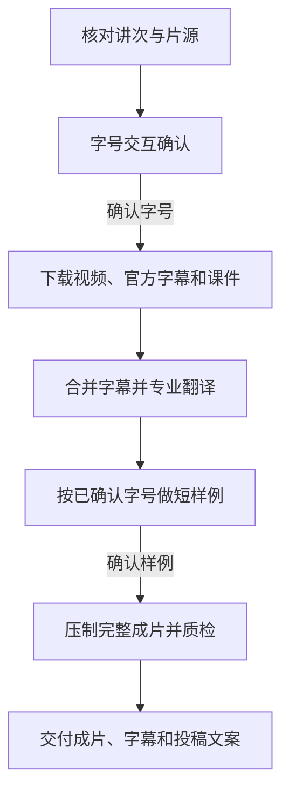

# 双语课程视频翻译 Skill

一个面向 [Codex](https://chatgpt.com/codex) 及其他 Agent 的课程视频翻译 Skill。把英文讲义或课程视频做成中英双语字幕成片：**保留英文原声，中文在上、英文在下。默认把字幕烧录在完整 16:9 画面底部；满幅幻灯没有安全空隙时，字幕放在该页下方，只在这些帧留底边，不遮挡课件。**

最重要的一步发生在翻译之前：Agent 必须先给出字幕字号的参考建议，询问你采用哪一套，确认后再开始翻译。

本仓库不是 Stanford 官方项目，与 Stanford University 无隶属或背书关系。仓库不含课程原片、官方课件、字体文件或私人账号。

## 它坚持的底线

- 先问字号，再翻译；推荐方案也要展示并等待确认，不能直接开翻。
- 结合课程语境做专业翻译，对照官方课件，不随便更换术语。
- 时间轴以官方英文字幕为准，不用自动字幕或无必要的 Whisper。
- 保留英文原声；整讲完整保留，不裁切、不拆分。学生提问、课堂讨论和老师的回答也完整保留，不因缺字幕、听众麦轻或听不清而静音或跳切；听不清用 `[INAUDIBLE]` 或只写听得清的词，不得臆补。
- 默认成片保持完整 16:9（1920×1080）。老师出镜和底部有空白的幻灯，字幕烧在画面内底部，整讲不加永久黑边。满幅幻灯（内容、图示、页脚铺满，没有安全空隙）不把字幕叠在页面上，改放在该页下方，只在这些帧可以留底边。不得盖住正文、图示、代码、页脚或页码，也不得为了统一给每一帧都垫黑边。
- 先出字号样例，再压完整成片；成片也要先预览。
- 官方字幕里的 `[INAUDIBLE]` 不得臆补。
- 本 Skill 交付成片和投稿文案，不自动发布到视频平台。

## 流水线



默认推荐的字号是已验证的「英文 48」自适应方案：全屏幻灯中英都用 48；老师出镜 2–3 行时中文 52、英文 48；出镜四行时回到 48/48。你也可以改成自己的数字。完整说明见 [`assets/typography-consult.md`](assets/typography-consult.md) 和 [`references/typography.md`](references/typography.md)。

## 安装

任选一种方式。安装后请重启 Codex；若技能列表里还没有，再重启一次。

### 方式一：克隆到个人技能目录（推荐）

```bash
git clone https://github.com/121209/bilingual-course-video-skill.git ~/.agents/skills/bilingual-course-video
```

若你平时把 Skill 放在 `~/.codex/skills`：

```bash
git clone https://github.com/121209/bilingual-course-video-skill.git ~/.codex/skills/bilingual-course-video
```

Windows PowerShell：

```powershell
git clone https://github.com/121209/bilingual-course-video-skill.git "$env:USERPROFILE\.agents\skills\bilingual-course-video"
```

克隆后应能看到 `SKILL.md`。如果目标目录已存在，不要覆盖你的本地修改。

### 方式二：放进某个仓库

把本仓库放到该项目的：

```text
.agents/skills/bilingual-course-video/
```

### 方式三：在 Codex 里安装

```text
请帮我从 GitHub 安装这个 Skill：
https://github.com/121209/bilingual-course-video-skill
安装后请先阅读 SKILL.md，告诉我它的流程、输入要求、输出格式和使用限制。
尤其注意：翻译前必须先向我询问字幕字号并给出参考建议。
```

也可以：

```text
$skill-installer install https://github.com/121209/bilingual-course-video-skill
```

## 怎么用

```text
使用 $bilingual-course-video 翻译 CS329Z 第七讲。
先按 skill 向我询问字幕字号并给出参考建议，确认后再开始翻译。
```

Agent 应先展示推荐方案（以及为什么这样建议），等待你确认或改数字，再下载片源和翻译。可复制提示见 [`assets/prompts.md`](assets/prompts.md)。

## 更新已安装的副本

GitHub 上的更新不会自动同步到已安装的 Skill。用 `git clone` 安装后，在对应目录执行：

```bash
git -C ~/.agents/skills/bilingual-course-video pull --ff-only
```

如果实际路径是 `~/.codex/skills/bilingual-course-video`，把上面的路径换掉即可。有本地修改时先备份再处理差异，不要强行覆盖。更新后如未出现在 Codex 中，重启一次。

## 仓库结构

```text
bilingual-course-video-skill/
├── SKILL.md                         技能入口、硬性规则和流水线
├── README.md                        本说明
├── LICENSE                          MIT
├── CHANGELOG.md
├── agents/openai.yaml               Codex 界面描述
├── assets/
│   ├── typography-consult.md        翻译前的字号交互（必做）
│   ├── lecture.AGENTS.md            单讲任务规则模板
│   └── prompts.md                   可复制提示
└── references/
    ├── typography.md                画布、字号、场景分类
    ├── download.md                  片源与官方字幕下载
    ├── terminology.md               专业术语对齐
    ├── encode.md                    压制参数与质检
    └── posting.md                   投稿文案和课件评论用语
```

## 致谢与边界

工作流整理自已完成并确认过的双语课程翻译实践，默认推荐方案以多讲成片验证过的英文 48 自适应字号为准。本仓库不包含第三方课程原片、课件、校徽或字体文件。使用时请确保你对输入的视频和课件拥有相应权限，并自行遵守原课程的使用与转载要求。
