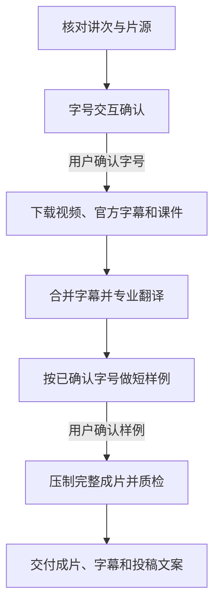

# 双语课程视频翻译

把英文课程视频做成中英双语字幕成片：保留英文原声，中文在上、英文在下，字幕烧录在完整 16:9 画面底部，不遮挡课件，不加黑边。

本仓库是独立的翻译工作流，不是 Stanford 官方项目，与 Stanford University 无隶属或背书关系。仓库不包含课程原片、官方课件、字体文件或私人账号信息。使用者须对所处理的视频和课件拥有相应权限。

## 硬性规则

1. **先问字号，再翻译。** 在开始翻译、合并中文稿或压字之前，必须完成 [字号交互确认](assets/typography-consult.md)：给出参考建议，询问用户采用哪套字号，并等到明确确认。不得把推荐方案当成已经批准的决定。
2. 结合课程语境做专业翻译，不要口语化意译，也不要随便更换专业说法。
3. 时间轴以官方英文字幕为准，不要用自动字幕或无必要的 Whisper。
4. 保留英文原声，不配音、不替换音轨。整讲完整保留，不裁切、不拆分成短片。
5. 成片保持完整 16:9（默认 1920×1080），不缩放、不裁切，四边不加黑边。中文在上、英文在下，烧录在画面底部：全屏幻灯放在正文下方的空白处，不得遮挡正文、代码 / IDE、图示、页脚标识或页码；若会压到页脚，收紧 MarginV 或折行，不要加黑边。老师出镜放在画面底部（讲台 / 桌面），不得挡住面部、肩部或手势。禁止 `pad=1920:1280:0:0:black`、画布 1920×1280，以及「字幕只画在黑边里」。
6. 字号确认后，先做短样例给用户看；用户确认样例后再压制完整成片。完整成片也要先预览，确认后再谈发布。
7. 官方字幕里残留的 `[INAUDIBLE]` 不得臆补，中英文都原样保留。

用户明确说「不用这个 skill」时，不要套用本流程。

## 流水线



任何一步需要用户决定时都停下来等，不要跳步。发布到视频平台不在本 Skill 的自动执行范围内。

### 0. 核对讲次与片源

确认课程、讲次、原标题、主讲和官方页面。下载前核对该讲在官方课程页上的视频 ID，不要凭记忆选用 YouTube 链接。若该讲有官方课件 PDF 或 notebook / 代码仓库，一并保存，翻译专有名词时要对照。详见 [片源下载](references/download.md)。

为这一讲建立独立任务文件夹，并放入 `AGENTS.md`（模板见 [assets/lecture.AGENTS.md](assets/lecture.AGENTS.md)）：

```text
<course>-lXX/
├── AGENTS.md
├── typography.md
├── src/
├── subs/
├── qc/
├── export/
└── posting.md
```

### 1. 字号交互确认（必做，且在翻译之前）

按 [字号交互确认](assets/typography-consult.md) 向用户展示参考方案并提问。默认建议采用已验证的「英文 48」自适应方案，完整规则见 [画面与字号](references/typography.md)。用户也可以指定其他字号。

把最终决定写入任务文件夹的 `typography.md`。在用户确认之前，不要开始翻译，也不要生成中文稿或 ASS。

### 2. 下载

按 [片源下载](references/download.md) 下载 1080p 画面、英文原声音频和官方英文字幕。用 ffprobe 核对分辨率、帧率、音轨和时长。课件 PDF 与课程页一并放入 `src/`。

下载可以在字号确认之后立刻进行；如果为了节省时间而提前下载，仍不得开始翻译。

### 3. 翻译与术语对齐

- 先把过碎的官方 CC 合并成可读 cue，合并上限约 10.5 秒 / 约 200 字符。
- 英文只做轻度清理：纠正明显识别错误和专有名词断裂，保持课堂口吻，不要全文改写。
- 中文面向研究生 / 开发者，对照官方课件用词。
- 系统名、论文名、API / 类名保持通行英文形式。课程概念用稳定译法，首次出现时可在中文后加英文对照。
- 本工作流默认：`agent(s)` 译为「智能体」，不要译成「代理」。
- `[LAUGHTER]` 译为「（笑声）」；`[VOCALIZES]` 这类非言语标记从展示中删除，不要编成词。

术语表见 [专业术语对齐](references/terminology.md)。拿不准时对照该讲官方 PDF / notebook，不要意译。

### 4. 字号样例

按已确认的字号生成 ASS，检查没有 5 行 cue，并列出所有英文小于约定字号的条目。先做短样例，建议覆盖：幻灯 2 行 / 4 行，出镜 2 行 / 3 行 / 4 行；如有代码或 Keynote，也要有一帧。把样例送给用户确认，未确认前不要压制完整成片。

### 5. 成片与质检

用户确认样例后，按 [压制与质检](references/encode.md) 出完整成片。质检至少包括：

- 成片时长与片源一致（允许与来源标称差 1 秒内）；
- 音频为原声拷贝，讲中无异常静音（片头片尾除外）；
- 抽帧确认成片为 16:9 / 1920×1080、没有额外黑边；字幕在画面内底部，未挡住幻灯正文、代码、页脚和脸，也未使用 `pad=1920:1280`；
- 音画与官方 CC 起止对齐。

### 6. 交付

同时交付：

- 完整成片（如 `export/` 中的 MP4）
- `bilingual.ass`、中英 / 双语 SRT 与 JSON
- `qc-report.md`
- 投稿文案 `posting.md`（结构见 [投稿文案](references/posting.md)）

把成片预览交给用户。本 Skill 到此结束。不要擅自发布到 B 站、小红书或其他平台；需要发布时，等用户明确要求后再由负责发布的助手执行。

## 按需阅读

- 向用户询问字号时，必须先读完 [字号交互确认](assets/typography-consult.md)。
- 字号、画布、折行和场景分类，读 [画面与字号](references/typography.md)。
- 下载命令和格式选择，读 [片源下载](references/download.md)。
- 术语拿不准时，读 [专业术语对齐](references/terminology.md)。
- 压制参数和质检项，读 [压制与质检](references/encode.md)。
- 起草简介和课件评论用语，读 [投稿文案](references/posting.md)。
- 可复制提示见 [assets/prompts.md](assets/prompts.md)。

已有成片不要直接覆盖，先备份。
